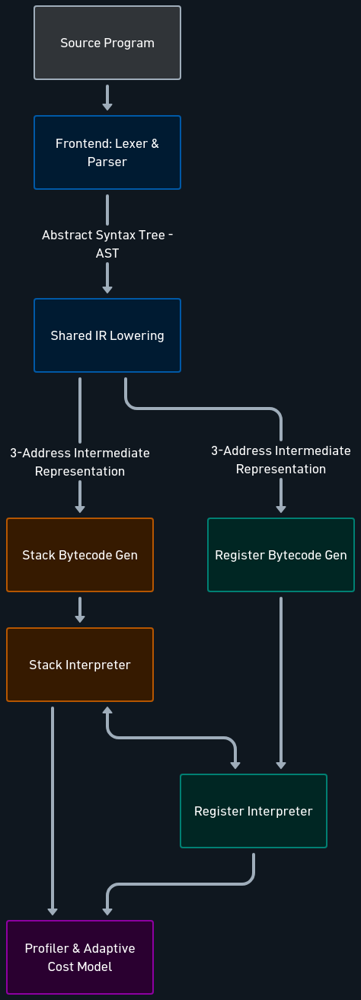

# AETHER: Adaptive Multi-Representation Compiler & Virtual Machine

[](https://www.python.org/downloads/)
[](https://opensource.org/licenses/MIT)
[]()

**AETHER** is a prototype compiler and adaptive virtual machine designed to investigate workload-aware selection between **stack-based** and **register-based** bytecode representations. 

Rather than locking an entire language runtime into a single fixed virtual instruction architecture, AETHER lowers source programs into a **shared, representation-neutral Intermediate Representation (IR)**, compiles both bytecode variants, and uses runtime profiling alongside a cost-minimization model to dynamically select the optimal execution representation at function boundaries.

---

## Key Features

* **Representation-Neutral Shared IR:** Lowers source programs into a clean, three-address intermediate representation before target code generation, ensuring strict semantic equivalence across execution models.
* **Dual Bytecode Generation:** Independently compiles the shared IR into both compact stack-oriented bytecode and explicit virtual-register bytecode.
* **Dual Virtual Machine Interpreters:** Includes a stack-based evaluation interpreter and a virtual-register interpreter sharing a unified runtime state.
* **Adaptive Cost-Minimization Policy:** Evaluates execution cost versus bytecode footprint using an explicit cost model ($J(f, r) = \alpha T(f, r) + \gamma B(f, r)$) to decide whether switching representations yields a net runtime benefit.

---

## Architecture Overview

AETHER lowers source code into a shared representation-neutral IR, compiles both stack and register bytecode variants, and uses function-level runtime profiling and a cost model to adaptively select representations[cite: 1, 3, 5, 6].

<p align="center">
  
</p>

---

## Project Structure

```text
aether_project/
├── lexer.py        # Lexical analyzer: converts raw source text into tokens
├── parser.py       # Recursive-descent parser: builds the Abstract Syntax Tree (AST)
├── ir.py           # Lowering pass: translates AST nodes into a shared 3-address IR
├── compiler.py     # Dual backends: generates stack and register bytecode from IR
├── vm.py           # Runtime engine: stack/register interpreters & adaptive cost policy
├── main.py         # Entry point demonstrating compilation, profiling, and execution
└── README.md       # Project documentation
```

---

## Getting Started

### Prerequisites
* **Python 3.8** or higher (no external third-party dependencies required).

### Installation & Execution

1. **Clone the repository:**
   ```bash
   git clone https://github.com/voidaniket/Aether_VM.git
   cd Aether_VM
   ```

2. **Run the prototype:**
   ```bash
   python3 main.py
   ```

---

## Example Output

Running `python3 main.py` compiles a multi-statement arithmetic program, inspects the shared IR, profiles execution across invocations, and evaluates the cost model:

```text
Source Program:
x = 10 + 5
y = x * 2
result = y + 4

--- Shared Intermediate Representation (IR) ---
t1 = LOAD_CONST 10
t2 = LOAD_CONST 5
t3 = ADD t1 t2
x = STORE_VAR t3
t1 = LOAD_VAR x
t2 = LOAD_CONST 2
t3 = MUL t1 t2
y = STORE_VAR t3
t1 = LOAD_VAR y
t2 = LOAD_CONST 4
t3 = ADD t1 t2
result = STORE_VAR t3

[compute_pipeline] Executing Stack Bytecode (Call #1)
Current Variables State: {'x': 15, 'y': 30, 'result': 34}

[compute_pipeline] Executing Stack Bytecode (Call #2)
Current Variables State: {'x': 15, 'y': 30, 'result': 34}

[Cost Model Evaluation for 'compute_pipeline']> Stack Cost: 10.5 | Register Cost: 13.8
-> Policy decision: Retaining stack representation.
```

---

## Roadmap & Future Extensions

- [x] Lexical analysis and recursive-descent AST parsing for arithmetic and variable assignments
- [x] Shared 3-address Intermediate Representation (IR)
- [x] Dual stack and register bytecode generators and interpreters
- [x] Function-level invocation profiling and deterministic cost-model evaluation
- [ ] Control flow support (`if`/`else` branching and `while` loops) with basic blocks
- [ ] User-defined functions, call frames, and parameter passing
- [ ] Differential semantic test suite and synthetic benchmark workloads (arithmetic, branch-heavy, call-heavy)
- [ ] Memory-budget constrained policy evaluation ($M_{\max}$)

---

## References & Inspiration

This prototype is inspired by research on stack versus register virtual machine architectures and adaptive multi-representation execution:
* **AETHER:** *Toward an Adaptive Multi-Representation Compiler and Virtual Machine*
* Gregg, D. et al., *"The case for virtual register machines"*, Science of Computer Programming (2005).
* Shi, Y. et al., *"Virtual machine showdown: Stack versus registers"*, ACM TACO (2008).

---

## License

This project is open-source and available under the [MIT License](LICENSE).